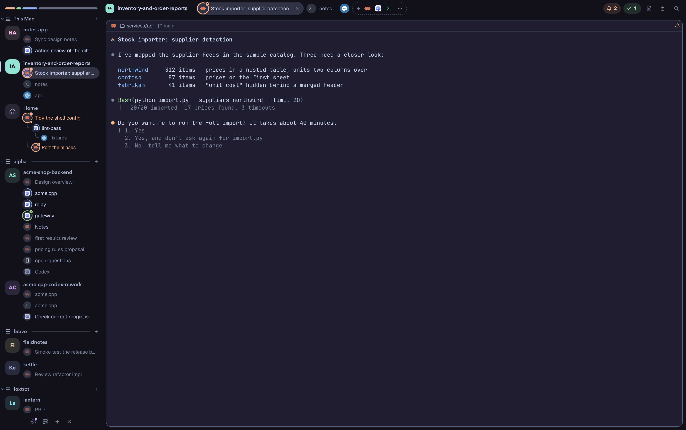

# Glyph

An icon-first window for watching coding agents. A dark rail on the left lists every machine, project and tab. A strip on top holds the shown project's tabs. A program is its logo, a state is a color and a motion, and a button is an icon. Words are kept for names and for what tells two agents apart. The colors are Catppuccin Mocha.

## What you see

Three regions: the rail down the left, the bar across the top of the rest, and the shown tab's panes below the bar. Text is Herdr's UI font (Geist). Letters that act as pictures are Avenir Next bold.

**Shared pieces**

- A project is a square tile with two letters ("notes-app" is NA, "kettle" is Ke). Each project gets one of six hues: `#94e2d5`, `#f9e2af`, `#b4befe`, `#cba6f7`, `#89dceb`, `#f5c2e7`. The tile is tinted at 15% with letters in the hue, and filled with `#11111b` letters when its project is on show. A project at home ("~") shows a house and is written "Home".
- A tab is a round orb with its program's logo at 60% of the orb.
- A dashed outline in `#45475a` is an empty place to start something.
- Red (`#f38ba8`) is something one more press will close.

**Rail**

- It is 256px wide on chrome `#11111b`, and resizes from 120px to 420px.
- A strip on top, 5px tall, shows every tab by state in four colored runs.
- Each machine with projects has a 26px line: a 10px chevron, a laptop or server icon, its name at 12.5px, a hairline, and a 18px "+". One machine alone gets no line.
- Under it, each project is a 36px tile beside its name at 13px. The shown project also has a 3px bar at the rail's edge.
- Each tab is a 28px row: a 20px orb and a label at 12.5px. The shown tab's row is raised (`#313244`).
- Each sub-agent is a 24px row under its tab's: a hook in `#45475a` hanging from the logo of whatever started it, a 16px orb and a name at 12px. A sub-agent is a terminal that one of the tab's agents started with Herdr's `hc run`, a helper agent or a plain program, and that has no pane.
- Machines with nothing running share one row of dashed pills at the end.
- A 42px foot has four icon buttons: settings, add a machine, new project, and one that switches the rail between 256px and 160px.
- Narrower than 200px, the rows go, sub-agents' too, and each project's orbs wrap beside its tile.

**Bar**

- It is 42px tall, and is also the window's drag strip.
- The shown project's 22px tile and name at 13.5px, and its machine if it is another one.
- Its tabs as 32px pills: a 24px orb and a title at 12.5px. The shown tab is raised and has an ×.
- A dashed pill of launchers: a plus, up to four installed agents' logos, the terminal logo, and three dots.
- On the right: a peach bell with a count and a green tick with a count when any tab wants you, then Files, Changes and search.
- Where the system draws no window buttons (Linux, Windows), minimize, maximize and close come last.

**Panes**

- Each pane is a card: 12px corners, a 1px border, `#b4befe66` when focused, 8px apart.
- Its 28px header shows the program's logo, the folder when it isn't the project's own, the branch, and the agent's state at the right.

**Empty page**

- A project whose last tab was closed shows a 56px tile, its name at 16px, and a larger dashed pill of the same launchers, centered.

## How it behaves

**Agent states**

- Working: a blue (`#89b4fa`) arc turns around the orb, once every 1.3 s.
- Blocked: a peach (`#fab387`) ring pulses and carries a "!" badge. The tab's label turns peach in the rail.
- Done: a green (`#a6e3a1`) ring with a tick badge.
- Idle: no ring. The logo fades to 75% after 15 minutes of rest and to 50% after two hours.
- A tab takes the most urgent state of its agents and their sub-agents. Sub-agents add one small dot in their most urgent color.
- A sub-agent's row shows working and blocked as a tab does, and its error counts as blocked. Finished or idle, the row is dim.

**Going places**

- Click a rail row or a bar pill to show that tab. Click a tile or a project's name to show the project.
- Click a sub-agent's row for Herdr's peek at its terminal, over the shown tab.
- Click a color in the strip at the top of the rail, or the bell or the tick in the bar, to go to the next tab in that state.
- Click the project's name in the bar, or search, for Herdr's picker.
- Scroll over the bar to step through its tabs.
- Hover anything for its words: a tab's title, project, machine, state, how long, and how many sub-agents; a sub-agent's name, title and state.

**Tabs**

- A tab's title is the name it was given, else its agent's own title, else nothing. The rail falls back to its folder or program.
- A sub-agent goes by the name it was started with (`hc run --name`), else its agent's own title, else its program.
- Titles in the bar share the room: short ones stay whole, long ones are cut to a common width, at most 240px. With under 32px each, every tab but the shown one shows its logo only.
- Double-click a tab, press F2, or right-click and choose Rename to name it. The dialog is Herdr's own, with the agent's title as its hint.
- Right-click a tab for Rename, New tab and Close.
- Drag a pill along the bar to move it. It lifts, the others slide aside in 140 ms, and it lands where it stands.

**Starting**

- A logo in the dashed pill starts a tab running that agent. The terminal logo starts a plain shell. The dots open Herdr's full "new" menu.
- ⌘T starts a shell, ⇧⌘C Claude Code, ⇧⌘O Codex.

**Closing**

- A plain shell closes at one press. Anything else takes two within 3 s: the first turns the tab red. This goes for ⌘W, a tab's ×, a pane header's ×, ⇧⌘W, and Close in the tab menu, whose row turns red in place.
- A pane alone in its tab closes the tab.
- After a close, the tab after it is shown, or the one before it for the last. Closing a tab that isn't shown moves nothing.
- Closing a project's last tab leaves the project on show as its empty page. A tab started there starts in the folder the last tab was in.
- The empty project closes once another project is shown, or at ⌘W on the page.
- When the project on show closes, the next project shows its first tab.

**Machines**

- Click a machine's name to fold its projects away, and again to bring them back. The chevron points down when they show and right when they are folded. Folded, the line shows the machine's tabs by state as a 4px strip. The fold is kept across restarts.
- "+" on a machine's line starts a project there. A dashed pill does the same for a machine with nothing running.
- A machine that needs a login is drawn in peach and says what to run on hover.

**Panes**

- Hover a pane's header for split right, split down and close. Zoom shows only when the tab has other panes.
- Files and Changes in the bar open Herdr's panels beside the panes.

## Built from

**Layout**

- `layouts/glyph.json`, with `layouts/glyph.svg` as the layout picker's thumbnail.
- Root: a row with `"titlebar": "none"`, `"traffic_lights": [14, 14]`, `"theme": "glyph"`, `"background": "canvas"`, `"terminal_padding": [12, 10]`.
- `sidebar`: a block, 256px, min 120, max 420, the mod with `{ "role": "rail" }`.
- `work`: a column that doesn't resize.
  - `bar`: a block, 42px, `window_drag`, the mod with `{ "role": "bar" }`.
  - `body`: a row, padding 8, gap 8.
    - `main`: a block with `{ "tab": "active" }`. Pane frames: gap 8, radius 12, `lone: true`, header 28px on top, always shown, the mod with `{ "role": "pane" }`.
    - `panel`: a hidden column, 368px (280 to 900), holding the stack `panel-body` of Herdr's `files` and `changes`.

**Theme**

`themes/glyph.json` is Catppuccin Mocha. The layout's root names it, so copy it to `themes/` with the layout. The mod asks `theme()` for its colors by name. Fixed in code are the six project hues, the `#11111b` ink on filled tiles and badges, and the terminal logo's `#4ec95f` when no shell is open to ask.

**Mod**

- `mods/glyph/`, whose `mod.json` is `{ "place": "none", "title": "Glyph" }`.
- `main.js` picks a part from `props().role`: `rail.js`, `bar.js`, `pane.js`, `menu.js` (a popup the mod opens for a tab) or `blank.js` (a project's empty page, as a tab's only pane).
- `data.js` shapes Herdr's lists into machines, projects and tabs. `ui.js` draws the tile, the orb and the icon button.
- `icons/`: 27 SVGs on a 24px grid with round strokes, drawn in `currentColor`. Program logos are Herdr's own, from `icons/` in Herdr's home (`~/.config/herdr-app`).

**From Herdr**

- Reads: `spaces`, `panes`, `terminals`, `agents`, `machines`, `focused`, `layout`, `window`, `settings`, `keys`, `updates`, `theme`, `props`, `knownAgents`.
- Calls: `run`, `hc`, `openOverlay`, `closeOverlay`, `nextCommand`, `notify`, `shared`, `setShared`, `setAgentOrder`.
- Shared values: `space.colors` (the hues, shared with Herdr's Spaces list), `new-menu.agents` (read), `glyph.blank` (an empty project's name and folder), `glyph.shut` (a close asked of the bar).
- Kept in the rail's `localStorage`: `seen` (since when each tab has rested) and `folded` (the folded machines). Each place the layout puts the mod is a copy with a `localStorage` of its own.
- Commands: `tab.select`, `tab.new`, `tab.close`, `tab.move`, `tab.next`, `tab.prev`, `space.select`, `space.new`, `pane.focus`, `pane.split`, `pane.zoom`, `pane.close`, `terminal.peek`, `mod.open`, `layout.resize`, `layout.select`, `layout.show`, `layout.hide`, `app.settings`, `window.minimize`, `window.maximize`, `window.close`.
- Herdr's own mods, opened as they are: `picker`, `menu` (the project menu), `prompt` (rename), `new-menu`, `machine-add`, `files`, `changes`.
- `setAgentOrder` follows the rail, so `agent.next` and `agent.prev` walk it top to bottom.

**Programs**

The rail runs `hc machine ls --json` every 20 s, to learn of machines without projects and of those that need a login. The mod reaches no network and reads no file outside Herdr's home.

**Keys**

`keys.json` holds a `layout:glyph` section. Each action is a command the bar waits for with `nextCommand()`: `rename`, `new`, `new-<key>` for any agent key in Herdr's program table, `close`, `close-pane`.

## Watch out

**Drawing**

- Herdr's UI font has one weight, so bold does nothing. Letters that must be bold use Avenir Next, a macOS font.
- A mod can't measure text. The bar shares its room among titles with a table of Geist's letter widths (`ADVANCE` in `ui.js`), which runs a few pixels wide, never narrow.
- There is no z-order. The dragged tab is a copy drawn last, and the original keeps its place at zero opacity.
- A slide is tied to its element's id. While a drag lasts every tab gets an id unique to that drag, so each drag starts its slides from rest.
- An element hears a release only over itself. A dragged tab lands 400 ms after the pointer leaves the bar unless it comes back, and any later press drops a drag whose release was missed.

**Closing**

- Herdr closes a project with its last tab and shows another project. The empty page is a tab whose only pane is the mod, opened just before the last tab closes. The rail and bar must not count it as a tab.
- With no terminal left, Herdr calls a project after the folder it was made in and starts new tabs there. The page's name and folder come from `glyph.blank`.
- A last tab that ends by itself gets no page: Herdr closes the project and shows the next one.
- A tab whose panes aren't known yet counts as more than a shell.
- Showing a tab also shows its project, so the bar never selects a tab in a project that isn't on show, except to move there.
- When the shown project closes, Herdr shows the next one on the tab it was last left on. The bar selects that project's first tab: before the page goes for ⌘W on a page, and just after for a close from Herdr's own menu or a last tab that ended by itself. A project that is only missing because its machine went out of reach is left alone.
- Every close ends in the bar's `shut()`, because a last tab has to wait for its page. The menu and the pane header ask through `glyph.shut`, since copies of a mod share code but not state.
- The bar runs its follow-up commands from a 120 ms timer, not from `render`. With nothing drawn it still looks about once a second.
- An error inside the loop around `nextCommand()` would end every key. The loop catches it and posts a notice.

**Sub-agents**

- Only terminals get rows. A helper that runs inside its agent's own process, such as Claude Code's Agent tool, is not a terminal, and Herdr reports nothing about it.
- A row lasts as long as its terminal. A program an agent runs through `hc run` and waits for has a row until it exits, so rows come and go.
- A sub-agent that was given a pane (`terminal.keep`, or keep in the peek) is a pane like any other and has no row. What it started is listed under the tab that holds its pane.
- The rail keeps times for tabs only, so a resting sub-agent does not fade by age as a tab does. It is dim at once.

**Keys**

- `keys.json` is written for macOS. Whoever installs the layout merges its section by hand into their own `~/.config/herdr-app/keys.json`, after the mod is in place: ⌘T and ⌘W go to the bar, and a bar that doesn't know a command ignores it.

**Titles**

- A terminal nobody titled reports its address as its title, which counts as none. So does a title that only repeats the program's name.
- Leading status glyphs and Codex's trailing " | project" are cut.
- An unnamed tab goes by its agent's title, not its number. That is why tabs have the mod's own right-click menu and rename hint. The project menu and ⇧F2 are Herdr's.

**Limits**

- The launcher pill shows at most four agents.
- The rail's default must stay labelled. A rail of logos alone did not say which agent was which.
- Not built: git ahead and behind counts, dragging to reorder projects, a custom toast, a menu on a sub-agent's row (the peek has keep and close). Zoom still shows in Herdr's terminal right-click menu for a lone pane, since a layout can only replace that menu whole.
- Built and checked on macOS with herdr-app 0.1.15. The window buttons for Linux and Windows have never been drawn there.
- The mod runs under any theme, but the hues, the ink on filled tiles and the focus border were picked for a dark one.

## Done when

- `herdr-app check mods/glyph` passes, and `herdr-app status` shows no errors with the layout on show.
- With projects on two machines, each has a line with its name, and machines with nothing running share one dashed row.
- An agent at work shows the turning blue arc. One that needs you pulses peach and raises the bell's count. One that finished wears the green ring and raises the tick's count.
- Clicking a rail row shows that tab. F2 opens the rename dialog with the agent's own title as its hint.
- An agent that runs `hc run --bg --name helper claude "…"` gets a row named helper under its tab, with the turning arc while the helper works. Clicking the row opens Herdr's peek at it.
- Dragging a pill moves the tab to where it stood when released.
- ⌘W on a shell closes it. ⌘W on an agent turns its tab red, and a second ⌘W within 3 s closes it.
- After a close the tab after it is shown.
- Closing a project's last tab leaves its empty page. A tab started there opens in the folder the last tab was in, and the page goes.
- ⌘W on the page closes the project, and the next project shows its first tab.
- Folding a machine hides its projects and shows the strip of their states.
